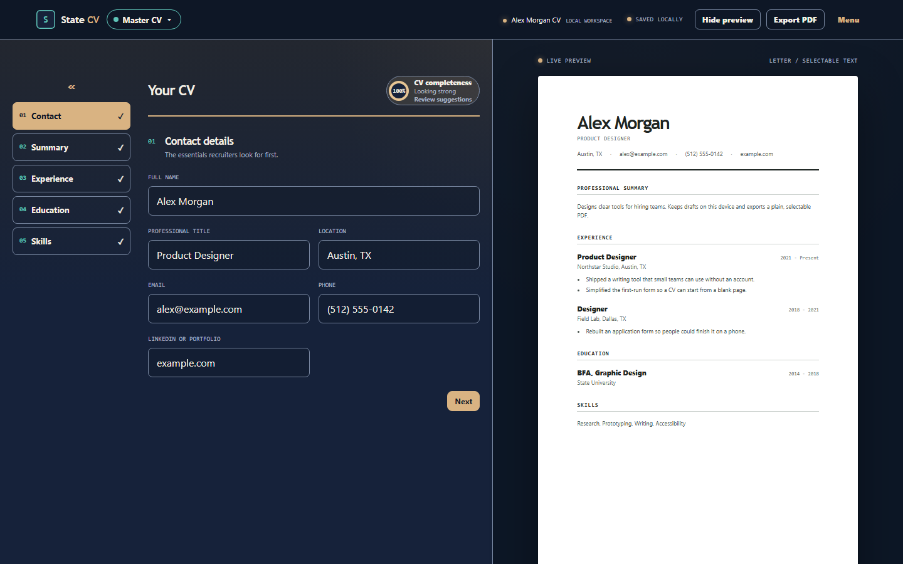

# State CV

State CV is a local-first CV builder by Native State Tools. Your CV stays in this browser.

The landing page is at the root of the site. The app is at `/app/`.

State CV now lives at https://cv.nativestatetools.com/ (app at https://cv.nativestatetools.com/app/). If you used State CV at an older address (native-state-tools.github.io/state-cv/ or nativestatetools.com/state-cv/), your saved CV stays there. Open the old address, open **Menu** (called **More** on an older copy) and choose **Backup (JSON)**, then use **Import** at the new address.

[Landing page](https://cv.nativestatetools.com/) · [Open the app](https://cv.nativestatetools.com/app/) · [About and privacy](https://cv.nativestatetools.com/about.html)

Contact: [hello@nativestatetools.com](mailto:hello@nativestatetools.com)



## How to use

1. Start a new CV, continue a saved one, or import a PDF or a JSON backup. PDF import is on the start screen and in the editor. JSON backups use **Import** in **Menu**.
2. The editor shows one section at a time: Contact, Summary, Experience, Education, and Skills. The preview updates as you type, and edits save in this browser. That storage is not a guarantee. The browser can clear it.
3. The CV you edit is the master CV. A tailored version is not a separate copy. It stays linked to the master: it records which entries, bullets, and skills to hide, plus an optional title, summary, and file name. Editing the master can change what a version shows. The version pill in the top bar switches between the master CV and a version. **Tailor** chooses what that version includes. Preview, PDF, and plain text follow the version you are viewing.
4. Open **Export** and check the ATS tips, or open **CV completeness** above the form and choose **Review suggestions**. Those checks run in the browser and follow the version you are viewing. The completeness percentage is separate: it is calculated from the master CV, it is not ATS approval, and a full score can still show a suggestion. The checks are not a guarantee that every applicant tracking system will read the file the same way.
5. Choose **Download PDF**, or use **Copy as plain text** or **Download .txt**. On a phone, **Export** is the bottom-bar view. On a wide screen, **Export PDF** opens the same options.
6. Download a backup from **Menu** (**Backup (JSON)**) or from **Your data** (**Download backup**). Importing that file replaces the current master CV and versions with the backup.

If the saved CV has content, or it has tailored versions, importing asks you to confirm first. A PDF import warns that your existing versions will be removed. A JSON backup replaces the current master CV and versions with the backup's contents. An older backup that has no versions replaces your current versions with none. The question mentions a snapshot only when one is kept: that happens when the current master CV has content. A blank master is not snapshotted. A blank saved CV with no versions, such as one from **Start a new CV** or **Start new CV** with nothing typed, does not ask. If the saved data could not be read, the question says that no snapshot copy is available.

## Run

```bash
npm start
```

Then open `127.0.0.1:3000` (landing) or `127.0.0.1:3000/app/` (app). The server uses only Node's built-in modules and does not install or download anything. The app also works by opening `app/index.html` directly in a browser.

## Tests

Run `npm install` and `npx playwright install chromium` once before testing; the app itself still needs no install.

```bash
npm run lint
npm run lint:selftest
npm run test:unit
npm run test:e2e
```

## Features

- Live CV preview with a plain layout and selectable text
- Local autosave with revision checks for multi-tab edits and up to five recent recovery snapshots. Browser storage is not a guarantee that the CV will still be there later
- One master CV, edited one section at a time (Contact, Summary, Experience, Education, Skills). Wide screens use a collapsible section list beside the form; narrower screens use a section tab row that stays at the top while you scroll. On a narrow screen each section name stays on one line, and the row scrolls sideways when the names do not fit. CV completeness stays above the form and opens review suggestions. That percentage is calculated from the master CV. The suggestions use the same ATS checks as Export for the version you are viewing. Completeness is not ATS approval, and a full score can still show a suggestion
- Tailored versions stay linked to the master. They are not independent copies. A version records what to hide, and can set its own title, summary, and file name. Editing the master can change what a version shows. The version pill switches which one you are viewing, and Tailor mode chooses what it includes. A long name is shortened in the pill; the version list and the pill's accessible name keep the full name. On a narrow screen, routine saving status sits on its own line under the top bar. Errors and the conflict notice stay readable. Preview, PDF, and plain text follow that choice
- Experience and education entries are cards you can collapse, expand, and reorder with buttons. Removing an entry can be undone
- A **Your data** dialog with the last-save time, approximate storage size, persistence request result and live browser status, snapshot restore, backup download, damaged-data download, and two-step clear
- JSON backup and restore (imports up to 2 MB). A backup replaces the current master CV and versions with the backup's contents. Older backups that contain no versions replace the current versions with none. Backups are validated before use
- PDF import with local selectable-text extraction (up to 10 MB and 20 pages); parsing disables scripting and eval features and stops after 30 seconds. PDF import removes existing versions
- If the saved CV has content, or it has versions, importing asks you to confirm first. The question mentions a snapshot only when the current master CV has content, so a snapshot is actually kept. A blank saved CV with no versions does not ask. If the saved data could not be read, the question says that no snapshot copy is available
- Native selectable-text PDF export in Letter or A4, with Compact, Standard, or Large text, clickable email and website links, and a warning when a character cannot be drawn. The layout is meant to be readable by applicant tracking systems. That is not a guarantee for every system
- Copy or download the same CV as plain text on this device
- ATS tips in Export, and the same checks in Review suggestions, run locally in the browser and send nothing anywhere. CV completeness is calculated in the browser from the master CV and is not sent anywhere
- Backup reminders are stored only in this browser and contain no CV content
- About and privacy page explains what stays in this browser and how to remove it. The same policy is in [PRIVACY.md](PRIVACY.md)
- Screens narrower than 1024px use an Edit | Preview | Export bottom bar. Export is its own view there, with page size, text size, the file name, ATS tips, and download actions. On a wide screen, Export PDF opens that same panel. Preview is full screen on narrower screens
- **Menu** holds Import, Backup (JSON), Your data, Support State CV, and Start new CV
- No account required. CV editing, import, and export stay in this browser. Support, contact, source, and Native State Tools links open outside pages only when you choose them, and they do not receive your CV

PDF import reads selectable text in the browser and maps common contact, summary, experience, education, and skills headings into the editor. It supports common single-column layouts, separate or combined role/company/date lines, numeric dates, month-name dates, and several heading variations. Image-only or scanned PDFs need OCR before they can be imported; heavily designed multi-column PDFs may still need a quick manual review because PDF text order is not standardized.

Letter is the default for US applications. A4 is available for international applications.

**Download PDF** creates a native Letter or A4 PDF with selectable text, controlled page breaks, and no browser date, URL, or page labels. The browser print dialog is only used as a fallback if the local PDF library cannot load. Export can also copy the CV as plain text or download a .txt file; both stay on this device. **Menu** holds Import, Backup (JSON), Your data, Support State CV, and Start new CV. The version pill switches between the master CV and a tailored version. Tailor mode chooses what that version includes. A version stays linked to the master, so master edits can change it.

## Offline operation

PDF.js 3.11.174 and jsPDF 2.5.1 are vendored locally in `vendor/`, and fonts use local system stacks. The Content Security Policy keeps scripts, styles, fonts, images, workers, and connections on this site. Loading State CV, and checking for an app update, requests this site's own files. Those requests do not include CV content. Support, contact, source, and Native State Tools links open outside pages only when you choose them. After the app files are cached, State CV can keep running with Wi-Fi disabled. Opening `app/index.html` directly does not register a service worker.

Drafts, snapshots, damaged-data copies, a one-time copy of a draft saved by an older version, and the browser-persistence request result stay in local browser storage. Older JSON backups still import. A downloaded backup uses the current format. After the first successful save, State CV requests persistent browser storage when the browser supports it; if the request is not granted, it retries on later page loads. The **Your data** dialog shows both the saved request result and the browser's current persistence status when available. Persistence is not a substitute for downloading a JSON backup. Storage behavior may differ when opening `app/index.html` directly from the file system compared with the hosted site.

## How updates work

The app shell is downloaded and cached as one version. When a newer version is found, it downloads in the background while the current version keeps running. State CV then shows an **Update now** notice; one tap applies the update and reloads the app. Nothing reloads automatically.

## License

Released under the MIT License. The vendored PDF.js and jsPDF distributions retain their original license notices.
