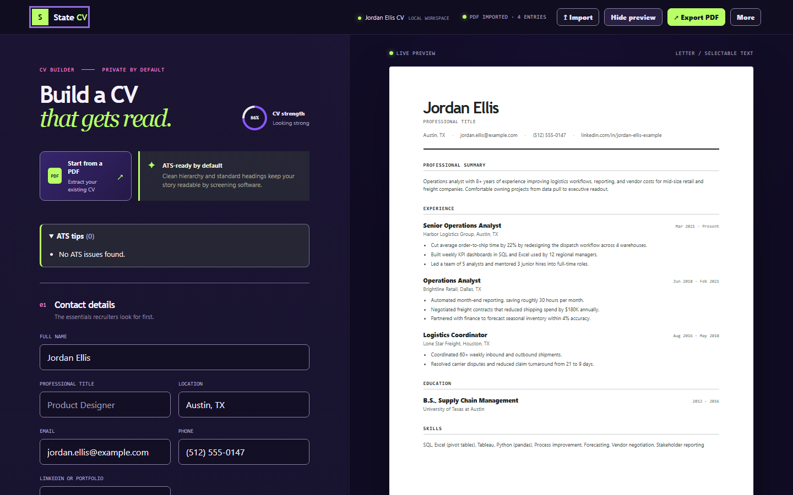

# State CV

State CV is a local-first ATS CV builder by Native State Tools. Your CV stays in this browser.

The landing page is at the root of the site. The app is at `/app/`.

State CV now lives at https://cv.nativestatetools.com/ (app at https://cv.nativestatetools.com/app/). If you used State CV at an older address (native-state-tools.github.io/state-cv/ or nativestatetools.com/state-cv/), your saved CV stays there. Open the old address, open **More** and choose **Backup (JSON)**, then use **Import** at the new address.

[Landing page](https://cv.nativestatetools.com/) · [Open the app](https://cv.nativestatetools.com/app/) · [About and privacy](https://cv.nativestatetools.com/about.html)



## How to use

1. Start a new CV, or import a PDF or a JSON backup. PDF import is on the start screen and in the editor. JSON backups use **Import**.
2. Edit contact details, summary, experience, education, and skills. The preview updates as you type, and edits save in this browser.
3. Check the ATS tips above the form.
4. Choose **Export PDF**, or open **More** and use **Copy as plain text** or **Download .txt**.
5. Download a backup from **More** (**Backup (JSON)**) or from **Your data** (**Download backup**).

If the saved CV has real content, importing a PDF or a JSON backup asks you to confirm before it replaces the current CV. A copy is kept in **Your data** under **Recent snapshots**. A blank saved CV, such as one from **Start a new CV** or **Start new CV** with nothing typed, does not ask. If the saved data could not be read, the question says that no snapshot copy is available.

## Run

```bash
npm start
```

Then open `127.0.0.1:3000` (landing) or `127.0.0.1:3000/app/` (app). The server uses only Node's built-in modules and does not install or download anything. The app also works by opening `app/index.html` directly in a browser.

## Tests

Run `npm install` and `npx playwright install chromium` once before testing; the app itself still needs no install.

```bash
npm run lint
npm run lint:selftest
npm run test:unit
npm run test:e2e
```

## Features

- Live ATS-friendly CV preview
- Local autosave with revision checks for multi-tab edits and up to five recent recovery snapshots
- Undo brings back a removed experience or education entry
- A **Your data** dialog with the last-save time, approximate storage size, persistence request result and live browser status, snapshot restore, backup download, damaged-data download, and two-step clear
- JSON import and export for backup (imports up to 2 MB); backups are versioned and validated before use
- PDF import with local selectable-text extraction (up to 10 MB and 20 pages); parsing disables scripting and eval features and stops after 30 seconds
- If the saved CV has real content, importing a PDF or a JSON backup asks you to confirm before it replaces the current CV. A copy is kept in **Your data** under **Recent snapshots**. A blank saved CV does not ask. If the saved data could not be read, the question says that no snapshot copy is available
- Native selectable-text PDF export in Letter or A4, with Compact, Standard, or Large text, clickable email and website links, and a warning when a character cannot be drawn
- Copy or download the same CV as plain text on this device
- ATS tips panel runs locally in the browser and sends nothing anywhere
- Backup reminders are stored only in this browser and contain no CV content
- About and privacy page explains what stays in this browser and how to remove it. The same policy is in [PRIVACY.md](PRIVACY.md)
- Responsive editor, full-screen preview, and an Edit | Preview | Export bottom bar on screens narrower than 1024px
- No account or external service required

PDF import reads selectable text in the browser and maps common contact, summary, experience, education, and skills headings into the editor. It supports common single-column layouts, separate or combined role/company/date lines, numeric dates, month-name dates, and several heading variations. Image-only or scanned PDFs need OCR before they can be imported; heavily designed multi-column PDFs may still need a quick manual review because PDF text order is not standardized.

Letter is the default for US applications. A4 is available for international applications.

The `Export PDF` button creates a native Letter or A4 PDF with selectable text, controlled page breaks, and no browser date, URL, or page labels. The browser print dialog is only used as a fallback if the local PDF library cannot load. The More menu can also copy the CV as plain text or download a .txt file; both stay on this device.

## Offline operation

PDF.js 3.11.174 and jsPDF 2.5.1 are vendored locally in `vendor/`, fonts use local system stacks, and the Content Security Policy blocks external scripts, styles, fonts, images, workers, and connections. State CV can run with Wi-Fi disabled and makes no external network requests.

Drafts, snapshots, damaged-data copies, and the browser-persistence request result stay in local browser storage. After the first successful save, State CV requests persistent browser storage when the browser supports it; if the request is not granted, it retries on later page loads. The **Your data** dialog shows both the saved request result and the browser's current persistence status when available. Persistence is not a substitute for downloading a JSON backup. Storage behavior may differ when opening `app/index.html` directly from the file system compared with the hosted site.

## How updates work

The app shell is downloaded and cached as one version. When a newer version is found, it downloads in the background while the current version keeps running. State CV then shows an **Update now** notice; one tap applies the update and reloads the app. Nothing reloads automatically.

## License

Released under the MIT License. The vendored PDF.js and jsPDF distributions retain their original license notices.
